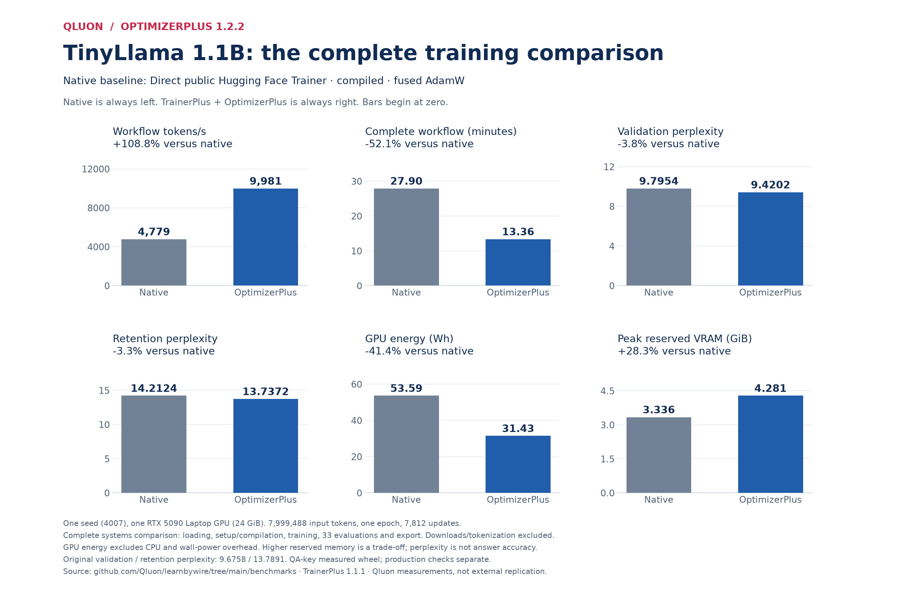
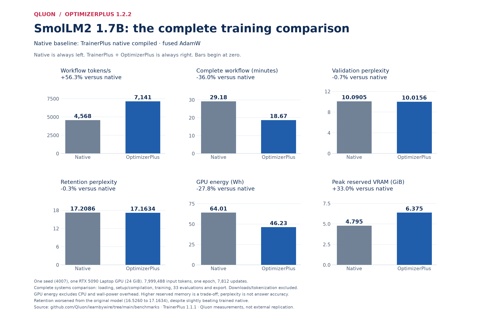

# Get more training from the GPU you already have

**A measured comparison of OptimizerPlus 1.2.2 and public native compiled AdamW**

Training efficiency is the time it takes to reach a useful, saved result. A fast stretch of training steps is valuable, but loading, compilation, evaluation and export still consume time. Quality, energy and memory determine whether that speed is useful.

OptimizerPlus is Qluon's proprietary control layer over an existing optimizer. TrainerPlus handles data preparation and training orchestration; LearnByWire supplies the shared interface. The underlying AdamW optimizer remains public PyTorch AdamW. LearnByWire and TrainerPlus are Apache-2.0 software.

## The strongest measured comparison

In a matched TinyLlama 1.1B workload, the complete TrainerPlus + OptimizerPlus system processed 9,981.3 valid input tokens per workflow second, compared with 4,779.2 for a direct public Hugging Face Trainer baseline using compiled execution and fused AdamW. The baseline training script imported neither TrainerPlus nor OptimizerPlus.

| Metric | Native compiled Hugging Face Trainer | TrainerPlus + OptimizerPlus | Relative change |
|---|---:|---:|---:|
| Full-workflow throughput | 4,779.2 tokens/s | 9,981.3 tokens/s | +108.8% (2.09×) |
| Complete workflow time | 27.90 min | 13.36 min | −52.1% |
| Final validation perplexity | 9.7954 | 9.4202 | −3.83% |
| Final retention perplexity | 14.2124 | 13.7372 | −3.34% |
| Sampled GPU energy | 53.59 Wh | 31.43 Wh | −41.4% |
| Peak allocated VRAM | 3.162 GiB | 3.413 GiB | +7.9% |
| Peak reserved VRAM | 3.336 GiB | 4.281 GiB | +28.3% |

The original model's validation and retention perplexities were 9.6758 and 13.7891. Lower perplexity is better on these fixed text panels. These measurements are not GSM8K answer accuracy or a test of hallucination.

Energy fell because the workflow finished sooner, even though average GPU power increased from 115.28 W to 141.19 W. Energy integrates power over elapsed time. The memory increase is a real cost: a workload near its device's memory ceiling may prefer a different configuration.

## What makes the comparison interpretable

Both arms use fused public AdamW, the same initial adapter within the model, the same token tensors and order, and the same training budget: one epoch, 7,812 updates and 7,999,488 valid input tokens. Sequence length is 512, microbatch is 1 and gradient accumulation is 2. Learning rate is a constant 0.0002 without external schedule warmup. The LoRA rank is 16, its standard scaling parameter is 32, and dropout is zero. Base weights are BF16 and adapters FP32.

The timer includes model loading, setup and compilation, training, 33 evaluation checkpoints and adapter export. It excludes shared downloads and tokenization. Tests used one RTX 5090 Laptop GPU with 24 GiB, Python 3.12, PyTorch 2.11.0+cu128, Transformers 5.8.0, PEFT 0.19.1 and Accelerate 1.13.0. GPU energy is sampled whole-device energy, excluding CPU and wall-power overhead.

The direct Hugging Face baseline also matched all 33 evaluation results and final adapter tensors of the TrainerPlus-hosted native compiled control. This establishes consistency for that tested configuration. It is a Qluon audit, not independent third-party replication.

## A second model, a different size of improvement

For SmolLM2 1.7B, the TrainerPlus + OptimizerPlus system reached 7,140.6 workflow tokens/s versus 4,568.3 for the TrainerPlus-hosted native compiled baseline: 1.56× throughput, 36.0% less workflow time and 27.8% less GPU energy. Reserved VRAM increased 33.0%. A direct Hugging Face Trainer arm was not measured for this model.

Final validation perplexity was 10.0156 versus 10.0905. Retention perplexity was 17.1634 versus 17.2086, but the original model was 16.5260: retention deteriorated from the starting model even though it slightly beat the trained native control. This is why the original model belongs in a results table.

## What these observations establish

The measured system improved workflow speed, final validation perplexity and sampled GPU energy on these two matched workloads, using more peak memory. There is one seed and one timing observation per arm on one GPU, and both models are Llama-style decoders. This is a complete systems comparison; it does not isolate optimizer control from accelerated model execution or show that every workload will improve.

The full-epoch measurements used a QA-key wheel. Production-key equivalence and fresh installation of the customer packages were checked separately. The fresh synthetic 50-update customer test verified training, adapter export and reload; it is not a throughput benchmark.

## Try a matched comparison on your workload

Start with the [first-run guide](../../GETTING_STARTED.md), [customer kit](https://github.com/Qluon/learnbywire/releases/download/v1.2.2/learnbywire-1.2.2-customer-kit.zip) and [pilot guide](../PILOT_GUIDE.md). OptimizerPlus requires a signed entitlement from Qluon. The release uses Linux x86-64, CPython 3.12 and a compatible NVIDIA GPU; check the documented requirements for your configuration. The examples do not limit which compatible models or data users may try.

Use your own native baseline, freeze the training and evaluation settings, and report full-workflow time, validation, retention where relevant, energy when measurable, and peak allocated and reserved VRAM. Agree on the success criteria before running. We are seeking external evaluations that can test where the benefit holds and where it does not.

Request access through [Qluon's pilot form](https://qluon.ai/contact.php?topic=pilot). Raw measurements, run identifiers, hashes and conditions are in the [public evidence record](../../benchmarks/README.md) and [machine-readable source](../../benchmarks/results.json).
